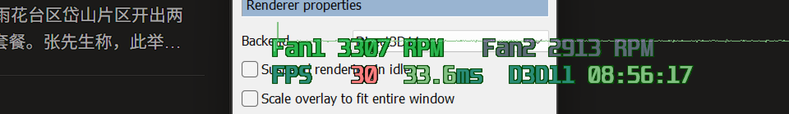

# WujieFan — 让笔记本 EC 风扇转速进入 RTSS 叠加层

MECHREVO 无界14+（ARN39P-TF / Ryzen 7 7840HS / ITE EC 2.12 / BIOS 2.31）的风扇转速，
从 EC 直接读取，并以两种方式呈现：

1. **独立界面** —— 托盘程序实时显示风扇转速与 CPU 温度，可开机自启。
2. **RTSS 叠加层** —— 作为 OverlayEditor 的**标准可拖动图层**出现，位置、字体、颜色都能在 OverlayEditor 里正常编辑。

## 现在的状态

| 能力 | 状态 |
|---|---|
| 从 EC 读风扇转速 | 完成，实测抖动 <1% |
| 托盘界面 / 开机自启 | 完成，自启动真实往返测试通过 |
| 托盘驻留 + 单实例唤回 | 完成，点 × 收进托盘，再次启动唤回原窗口 |
| 进入 RTSS，且**可拖动编辑** | 完成，端到端实测通过 |
| 一键注入图层（幂等 + 可回滚） | 完成 |

数据链路是：

    EC 寄存器 (0x181E / 0x1820)
      → WujieFan（管理员权限，经 PawnIO + LpcIO.bin）
      → 命名共享内存 AIDA64_SensorValues
      → RTSS OverlayEditor 的 AIDA 数据源
      → %WUJIE Fan1 RPM% 宏 → 图层文字

实际效果（右上角两段风扇转速就是注入的图层，可拖动、可改字体颜色）：

之所以绕道 AIDA 共享内存，是因为 RTSS 只认识它自带的那几个数据提供方（HAL / AIDA / HwInfo /
MSI Afterburner / LHM / PresentMon…），而**没有一个提供笔记本平台风扇**。AIDA 通道是唯一
「不需要改 RTSS 本身、也不需要往 RTSS 进程里塞插件」的入口。

## 下载

不想自己编译就直接拿打包好的版本：[Releases](https://github.com/Thousand00/wujiefan/releases/latest)。

| 包 | 大小 | 前提 |
|---|---|---|
| `WujieFan-0.1.0-win-x64.zip` | 146 KB | 需 .NET 8 桌面运行时 |
| `WujieFan-0.1.0-win-x64-portable.zip` | 62.6 MB | 免运行时，解压即用 |

自己打包：`powershell -File tools\make-release.ps1 -Version 0.1.0`，产物在 `dist\`。
## 快速开始

### 1. 运行主程序

    dist\app\WujieFan.exe

会弹 UAC —— 这是必须的，PawnIO 驱动只对 SYSTEM 与 Administrators 开放。
勾选「开机自动启动」后，下次登录会以管理员身份自动运行并缩到托盘。

### 2. 让图层出现在 RTSS 里

先确认 WujieFan 在跑、且勾选了「向 RTSS 提供数据」，然后：

    python tools\add-wujie-layers.py "C:\Users\<你>\Desktop\default.ovl"

这会在布局里加入 3 个数据源（Fan1 / Fan2 / CPU 温度）和 2 个图层。
之后**重启 RTSS** 才会生效（RTSS 没有热重载）：

    powershell -File tools\restart-rtss.ps1

打开 OverlayEditor，即可拖动「CPU Fan RPM」/「GPU Fan RPM」两个图层。

**这个脚本是幂等的**：重复运行不会重复添加，只会原地更新。
想撤销就用 `--revert`，想先看看会改什么就用 `--dry-run`。改之前会自动备份成
`<文件名>.bak-wujie-<时间戳>`。

### 3. 关掉窗口不会退出

点右上角 × 只是收进托盘 —— 读数与供数照常继续，首次会弹一个气泡提示。

- 唤回窗口：双击托盘图标，或右键 →「显示主窗口」，或**再运行一次 exe**（不会开第二个进程，而是把已有窗口叫到前台）。
- 真的退出：右键托盘图标 →「退出 WujieFan」。

### 4. 排查工具

    python tools\read-aida.py -n 3          # WujieFan 到底写没写、写的数对不对
    python tools\peek-overlay.py --full     # RTSS 实际渲染出来的图层文本
    python tools\peek-overlay.py --slots    # 列出全部 8 个 OSD 槽的占用者

顺序很重要：**先确认供数（read-aida），再看渲染（peek-overlay）**。

如果数值都对、`peek-overlay` 里也有图层文本，但屏幕上就是看不见，那几乎一定是坐标跑出了渲染区。
`.ovl` 的 `PositionX` 不是绝对像素，负值向右、数值过大会让图层静默消失（`-120` 就完全看不见，`-16` 正常）。
详见 [docs/01-现状与技术总结.md](docs/01-现状与技术总结.md) §9A.10。

## 目录

    assets\                程序图标源文件
    src\WujieFan\          主程序（WinForms .NET 8 x64）
    src\WujieFan.Core\     核心库：读 EC / 机型校验 / AIDA 供数 / 设置 / 自启
    tests\EcReadSmoke\     命令行验证工具（含自启动往返测试）
    tools\                 注入脚本、诊断脚本、RTSS 重启脚本
    docs\                  技术文档（先读 01-现状与技术总结.md）
    docs\archive\          失败实验的原始资料
    dist\app\              发布产物（不入库，可重建）
    backup\                改动前的 RTSS 原始配置，用于还原（不入库）

## 技术文档

- [docs/01-现状与技术总结.md](docs/01-现状与技术总结.md) —— EC 寄存器表、RTSS 内部机理、
  六条数据通道的调研结论、失败的插件实验与真正原因、AIDA XML 解析器的硬性约束、踩坑清单。

## 关键前提与风险

- **必须管理员权限**。PawnIO 设备对象的 SDDL 只放行 SYSTEM 与 Administrators。
- **只支持这一款机型 + EC 2.12**。寄存器地址是从这个固件逆向出来的，机型或固件版本不符时
  读出来的数字看着合理但完全错误 —— 所以程序会直接拒绝，而不是「尽力而为」。
  确有需要可用 `ForceUnsupported` 强开，后果自负。
- **本程序只读 EC，不写 EC**。不碰风扇曲线、不碰 PWM。本程序不发出任何 EC 写操作。
- **PawnIO 的 LpcIO.bin 模块是 LGPL 2.1**。本程序把它作为嵌入资源分发，因此同样适用 LGPL 2.1：
  你可以替换它。源码与许可见 <https://github.com/namazso/PawnIO>。
- RTSS 需要 7.3.x，且 `Plugins/Client/Overlays` 里的布局文件请自行备份。
- 布局文件的编码是混合的（OEM 自带图层名是 GBK 字节），工具脚本用 latin-1 读写以保持字节不变，
  **不要用记事本另存为 UTF-8**，否则原有中文图层名会变乱码。

## 源码仓库

<https://github.com/Thousand00/wujiefan> —— 默认分支 `master`。

文档：

- [现状与技术总结](docs/01-现状与技术总结.md) —— 硬件/固件事实、EC 寄存器表、RTSS 各数据通道调研、
  程序结构、踩坑速查。要改这个项目或复现这套做法，先读它。

运行时不进仓库：`dist/`、`bin/`、`obj/` 均在 `.gitignore` 里，需要时用
`dotnet publish src\WujieFan\WujieFan.csproj -c Release -o dist\app` 自行构建（先退出正在运行的实例）。

`backup/` 存的是改动前的 RTSS 原始配置（布局与 profile），出问题时用于还原，同样不入库，
说明见 `backup/README.md`。

## 许可

本仓库自有代码为 MIT。内嵌的 PawnIO 模块为 LGPL 2.1。
